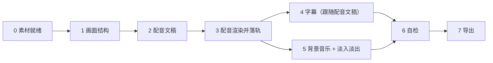

# Aixcut 成片编排

这个技能只管"顺序和依赖"，每个阶段的具体做法由对应技能负责。一次成片要同时满足用户的画面、声音和文字要求，缺一项都算没做完。

## 适用范围

适用：

- "帮我把这些素材剪成一条 60 秒的宣传片，要配音、要字幕、要音乐"。
- "这条片子太长了，剪成 30 秒，配个旁白"。
- 任何一次会同时动到配音、字幕、音乐或成片结构的多步需求。

不适用：只改一个字幕、只换一个片段、只导出——那些直接走对应技能，不要拉起整套流程。

## 动手前先对齐

缺一个就问一个，不要自己拍板：

1. **成片目标**：时长、画幅、平台、用途。
2. **要不要声音**：要不要配音？要不要背景音乐？音乐要不要压过画面原声？
3. **要不要文字**：要不要字幕？字幕跟配音文稿还是跟说话内容？
4. **素材策略**：用现有素材，还是还需要用户再上传。

如果用户要求多个版本、A/B、横竖版或平台适配，先调用 `aixcut_timeline(action="list")`，再为每个版本复制时间轴。后续每个版本的读写都必须带自己的 `timeline_id`；生成素材仍按 Project 复用，不要为每个版本重复生成。

用户明确说"直接做完别问我"时才跳过对齐，但做完要在汇报里写清你替他做了哪些决定。

## 执行顺序

顺序不能换。语音时间决定下游一切，字幕、音乐长度、画面节奏都以它为准。

1. **素材就绪**：先读项目，确认素材够不够、分析有没有完成。缺素材或素材没分析完，先解决，不要开始剪。素材要用户新导入时，按 `aixcut-timeline-editing` 的「本机素材」走，等确认出现在 `sources` 里再继续。
2. **画面结构**：按目标时长排画面顺序和每段时长。这一步定下来的结构决定配音要多长。
3. **配音文稿**：写文稿，选音色，提交合成。
4. **配音落轨与转录**：合成成功只代表音频素材生成好了，必须再把它放到时间轴，并回读音频源 `transcript_status`。只有转录可用才能进入自动字幕；等待或失败都要如实报告。
5. **字幕**：对已落轨且 `transcript_status=available` 的旁白音频执行 `aixcut_caption(regenerate)`，读回 `captions` 验证。不要仅凭配音文稿声称语音转录已完成。
6. **背景音乐**：用 `aixcut_audio` 加一条独立音乐轨，两端加淡入淡出，并用 `volume` 压低音量让配音听得清。
7. **自检**：读回时间轴和配音，逐项核对用户提过的要求。
8. **导出**：按 `aixcut-export` 调用项目页面导出并轮询。成片由用户浏览器直接下载，只汇报文件名和体积。

每一阶段的读写细节见 [references/pipeline.md](references/pipeline.md)。

## 检查点

除非用户要求一次跑完，否则在这三处停下来汇报一次：

- 画面结构排完、配音开始前：确认时长和节奏是不是用户想要的。
- 配音落轨、字幕生成前：确认文稿和音色没问题。
- 导出前：确认成片结构和时长。

## 高频漏项

这几条是真实踩过的坑，每一条都必须在自检里逐项确认：

- **配音合成完成不等于配音进了片子。** 合成只产出音频素材，还要单独把它放上音频轨。这是最容易漏的一步。
- **字幕默认来自配音文稿，不是视频逐字稿。** 没有口播台词的素材通常没有逐字稿，指望自动转写会得到空字幕。
- **生成配音不代表生成了字幕。** 配音音频落轨后还要确认其转录状态；只有 `available` 才能重建字幕并读回验证。
- **音乐默认要淡入淡出。** 不加的话开头结尾会很突兀。
- **先用 `aixcut_frontend(action=analyze_music_beats)` 读取音乐节拍证据。** 只有返回 `status=available` 和 `beat_times_ms` 才能按节拍选切点；否则报告“无法判断”，不能靠听感估 BPM。
- **配音和音乐同时存在时要区分主次。** 音乐盖住讲解声是最常见的成片问题。
- **本机素材由浏览器持有原片。** 本机视频不走完整原片上传；有声音时只提取音频做转录，画面理解按需抽帧，最终成片统一由项目页面导出。不要把本机原片当成缺失。

## 完成判定

用户的每一条要求都要有一条读回结果对应，通常用 `aixcut_read` 读 `timeline`、`voice`、`captions`，再用 `aixcut_review` 做结构检查。

汇报时说清：成片时长、画面片段数、配音段数和时长、字幕条数、音乐轨和淡入淡出、以及导出结果。没有做到的要直说，不要用"应该没问题"含糊过去。
没有实际播放导出文件时，还要明确写“完整播放/试听未验证”。
