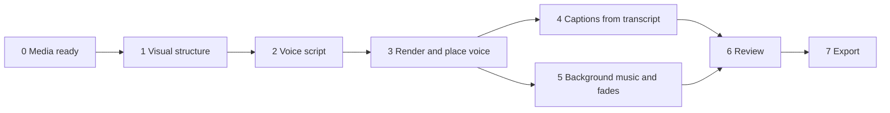

# Aixcut Video Assembly

## Conversation guidance

Keep the user oriented at each stage without turning the workflow into a fixed questionnaire. If the goal is clear, inspect the Project and media, then continue safe work. Pause only for a consequential unresolved choice, permission, unaccepted cost or credits, or overwrite/deletion risk. At handoffs, state what is complete, what is next, and whether the user needs to act.

This Skill owns the order and dependencies between stages; each specialist Skill owns its detailed procedure. A finished video must meet the user's visual, audio, and text requirements.

## Scope

Use this Skill for multi-stage work, such as turning source media into a 60-second promo with voiceover, captions, and music, or shortening a video and adding narration. For a single caption, clip replacement, or export, use the corresponding specialist Skill directly.

## Align before acting

Resolve only relevant decisions that are still missing; treat this list as a guide, not a questionnaire:

1. **Video goal:** duration, aspect ratio, platform, and use.
2. **Audio:** voiceover? Background music? Should music sit below original audio?
3. **Text:** captions? Should they follow the voice script or source speech?
4. **Media:** use existing assets or ask the user to upload more?
5. **Content language:** follow the language policy. Do not infer the finished video's language solely from the conversation language.

If the user requests multiple versions, A/B, portrait/landscape, or platform variants, first call `aixcut_timeline(action="list")` and duplicate a timeline per version. Include each version's `timeline_id` in later reads/writes. Generated assets are Project-scoped and can be reused; do not regenerate them for each version.

Ask one concise question at a time. If the user requests uninterrupted end-to-end execution, use reasonable reversible defaults for non-blocking choices and report them. Still resolve choices that materially change the content language, incur an unaccepted charge, or risk overwriting existing work.

## Required order

Voice timing anchors downstream work. Do not reorder these stages:

1. **Media ready:** Read the Project and check whether assets and analysis are ready. Resolve missing media or analysis first. If the user needs to add files, follow “Local media” in `aixcut-timeline-editing`; continue only after the assets appear in `sources`.
2. **Visual structure:** Arrange shots and durations to fit the target. This determines the required voice length.
3. **Voice script:** Write the script in the requested content language, choose a voice profile, and submit synthesis.
4. **Place and transcribe voice:** Successful synthesis only means the audio asset exists. Place it on the timeline, then read the source `transcript_status`. Only `available` is ready for automatic captions; report pending or failed status accurately.
5. **Captions:** For voiceover with `transcript_status=available`, call `aixcut_caption(regenerate)` and read back `captions`. Never claim transcription is complete from the voice script alone.
6. **Background music:** Add a separate audio track with `aixcut_audio`, add fades at both ends, and lower `volume` so narration remains clear.
7. **Review:** Read the timeline and voice state and check each stated requirement.
8. **Export:** Use `aixcut-export` to export from the Project page and poll status. The browser downloads the file; report its filename and size.

Detailed stage instructions are in [references/pipeline.md](references/pipeline.md).

## Stage handoffs

Stage changes are status updates, not confirmation gates. After laying out visuals, report pacing and continue to voice synthesis when the request is clear and safe. After placing voice, report the script and voice profile, then continue to captions and music. Before export, summarize the structure and verified checks.

Pause only when available media cannot meet the goal, different interpretations would produce materially different edits, a generation charge or credits have not been accepted, existing work may be overwritten or deleted, or the user asked to review before continuing. Ask only about the most important unresolved choice and recommend an option.

For upload, asynchronous generation, voice rendering, transcription, or export, continue status checks when possible. If user action is required, state the exact action and what will allow work to resume.

## Common misses

- **Rendered voice is not yet in the video.** Synthesis creates an audio asset; place it on an audio track separately.
- **Captions are not automatically the voice script.** A visual-only source may have no transcript. For narration, check the audio transcript state after placing voice.
- **Voice generation does not imply captions exist.** Wait for `available`, regenerate captions, and read them back.
- **Music needs fades.** Without fades, it can start or stop abruptly.
- **Read actual beat evidence with `aixcut_frontend(action="analyze_music_beats")`.** Only use beat-based cut points when the result has `status=available` and `beat_times_ms`. Otherwise report that beats could not be determined; do not estimate BPM by ear.
- **Balance voice and music.** Music overpowering narration is a common quality issue.
- **The browser owns local source files.** Full local video is not uploaded. Audio may be extracted for transcription and visual understanding uses on-demand frame capture. The Project page performs final export; do not treat local originals as missing.

## Completion

Each user requirement must map to a read-back result. Usually read `timeline`, `voice`, and `captions` with `aixcut_read`, then inspect structure with `aixcut_review`.

Report total duration, visual clip count, voice segment count and duration, caption count, music track and fades, and export status. State any incomplete work plainly. If the exported file was not actually played, say “full playback/listening not verified.”
