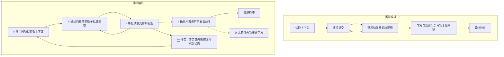

# MCP 剪辑提速实施方案

> 执行方式：使用 `executing-plans`，在当前工作树按阶段推进。源码、实时工具契约和实测数据优先于历史方案。

**目标：** 在保留原声、字幕真实性、MG 轨道隔离和结果验证的前提下，减少剪辑过程的重复调用和等待。

**架构：** 首先固定版本并测量真实 MCP 工作流，再优化 Plugin 的调用编排。只有测量证明服务端是瓶颈时，才单独修改 MCP Server；外部 MCP 剪辑不经过 Studio 内部 AI 的沙箱工作流。

**技术栈：** Markdown Skill、TypeScript/Vitest 契约测试、MCP、Zero、浏览器素材处理。

## 一、范围与现状

- 主实施仓库：`agent-plugin`，分支 `codex/aixcut-plugin-language-and-guidance`。
- 基线源码：`293bb6a60b69f2b7c0f1eb0a22d40ca38790560c`。
- 提示词真源：`shared/skills/`；通过 `npm run build` 生成发行目录，不单独维护生成副本。
- 本任务提交、推送另行按工作区规则确认；其他工作树和 MCP Server 中已有未提交修改不纳入本任务。
- 已安装 Plugin 的 24 个 Markdown 文件中有 7 个与上述版本不同。控制试验须显式读取固定版本；磁盘更新不代表当前会话已重新加载 Plugin。

目前只能确认存在重复读取、逐项操作和固定阶段要求的优化空间，尚不能确定它们占总耗时的比例。

源码证据：

| 位置 | 当前行为 | 意义 |
| --- | --- | --- |
| `shared/skills/aixcut-verification/SKILL.md` | 结构写入后立即读取受影响视图 | 应以支持的原子批次为检查单位，不能删掉验证 |
| `shared/skills/aixcut-video-assembly/references/pipeline.md` | 多阶段重复读取，字幕步骤要求 regenerate | 已自动派生的有效字幕可能无需再次重建 |
| MCP Server `src/modules/timeline-editing/handler.ts` | 写入读取完整快照，相关操作后自动派生字幕 | 提示词无法单独把服务端派生改成每阶段一次 |
| MCP Server `src/nle/zero-client.ts` | 请求级授权、快照、服务端收据 | 不能用跨请求共享客户端替代授权和提交确认 |

ChatCut 可借鉴的是公开工具契约中的批量编辑、多视图读取和按阶段核验。其服务端实现不可见，也尚未做同条件性能对测，不把“ChatCut 更快”作为已验证结论。

## 二、当前与目标编排

图例：🆕 新增；⚡ 修改或复用；❌ 拟去除的冗余路径。

保留每批写入后的核验和最终质量检查；合并契约支持的同类操作，去除重复读取及无条件重复派生。时间轴状态仍由服务端管理，素材导入、截图和导出仍由在线项目页面执行。

## 三、第一步：建立性能基线

### 产物

- `docs/plans/2026-10-12-mcp-editing-performance-baseline.md`：环境、版本、输入、实测结果及未完成项。
- 测试隔离的新项目，不修改现有家庭聚会或柠檬水项目。
- 调用记录仅保留工具、动作、阶段、开始/结束和状态；不保存令牌、完整工具响应或原始素材内容。

### 执行顺序

1. 固定 Plugin Git SHA；读取该版本 Skill，记录与安装包差异。完整 A/B 使用新会话和相同加载方式，避免本长会话污染结果。
2. 固定桌面 `柠檬水制作` 文件夹的三份素材，记录大小、哈希、媒体时长和输入提示词。
3. 读取服务健康及指标，记录采样区间。计数器清空、进程重启或并发请求时，不跨区间计算指标差值。
4. 已完成五类只读视图各三次采样；单独记录冷调用，不把微基准等同于全流程。
5. 新建 `MCP提速基线-柠檬水` 项目，核实页面在线，启动或复用官方本地桥，三文件一次导入；只轮询返回的 import_ids。
6. 通过 MCP 完成素材读取、镜头安排、原声处理、字幕和可支持的视觉标注；不用 Studio 内部 AI，不生成未经请求的配音或音乐。
7. 记录每阶段总时间、调用次数、各调用耗时、调用之间的等待、ASR/导入耗时、失败和重试。模型思考时间若不可独立观察，只标记“调用间隔”，不能全部归因于模型。
8. 做结构和代表帧核验，列出不支持的动画或缺少的素材。没有播放/试听证据时，不能声称成片质量全部通过。

### 固定场景

15–20 秒、9:16 柠檬水食谱视频；主持人开场 → 食材 → 高角度制作硬切 → 主持人结尾。保持主持人原声，B-roll 左下角画中画，底部短语字幕，食材标签/箭头及关键动作虚线圆圈。

音乐是可选项，默认关闭；不新增 AI 配音。不存在对应 MG 资产或创建能力时，标记未完成，不能将 MG 塞进字幕轨道，也不能用静态字幕冒充动画。

### 退出条件

完成至少一轮可追溯工作流并验证结果，才能进入效果对比。页面离线、素材无法导入或版本不可确认时，先记录具体阻断，不以微基准宣称全流程基线完成。

## 四、第二步：优化 Plugin 编排

**预计文件：**

- `shared/skills/aixcut-basics/SKILL.md`
- `shared/skills/aixcut-timeline-editing/SKILL.md`
- `shared/skills/aixcut-video-assembly/SKILL.md`
- `shared/skills/aixcut-video-assembly/references/pipeline.md`
- `shared/skills/aixcut-captions/SKILL.md`
- `shared/skills/aixcut-verification/SKILL.md`
- `tests/contracts/editing-efficiency-guidance.test.ts`（新增）
- 已有 `audio-intent-guidance.test.ts`、`motion-graphics-guidance.test.ts` 中对应约束。

### TDD 步骤

1. 新增失败的契约测试：支持批次后读回；禁止同时间轴并发结构写入；位置相关命令必须刷新；警告/冲突/外部变更刷新；无请求不生成音频；MG 专用轨道和读回仍保留。
2. 运行 `npx vitest run tests/contracts/editing-efficiency-guidance.test.ts`，确认失败来自缺少规则。
3. 修改最小规则并统一引用，避免在每个 Skill 复制长段指令：
   - 同项目、同时间轴且状态未变化时复用已读证据；服务端仍验证 revision 和权限。
   - 仅将实时 Schema 支持的同动作、同轨道内容组合为 `items[]`/`targets`。不杜撰混合批量 API，也不强制所有动作批量化。
   - 独立只读调用可并发；同一时间轴结构写入串行。
   - 每个原子批次成功后立即读受影响视图；必要时额外读取。最终验证逐维度保留。
   - 已由服务端派生且与当前语音/时间轴一致的字幕不再次无条件 regenerate；保护 manual 模式。
   - 一次获取多个代表帧，不对时间或音量单独变化截图；新布局与遮挡修复仍需截图。
   - 无需配音/音乐的分支跳过对应动作；`needs-clarification` 流程图改为真实暂停，和文字规则一致。
4. 运行三个相关契约测试文件，确认安全约束未退化。
5. 稳定后执行一次 `npm run check`，生成各发行目录并校验；不重复执行它已覆盖的命令。

## 五、第三步：验证实际提速

在新会话、新项目、相同素材和模型条件下，对固定旧版与新版各运行三轮。首次导入/缓存与已有素材分别统计，按轮交错运行降低时间段偏差。

| 指标 | 通过要求 |
| --- | --- |
| 重复调用 | 在同一场景中有可解释的减少，不以跳过验证实现 |
| 总时长 | 中位数下降；初始目标 20%，不是提前承诺 |
| MCP 调用与媒体等待 | 分项报告，不把 ASR 波动归因于提示词 |
| 失败/重试 | 不增加冲突、重复导入、重复写入 |
| 质量 | 时长、画幅、剪辑顺序、原声、字幕真实性、MG 隔离均无退化 |
| 未支持需求 | 新旧两组同样公开，不能以省略需求换取提速 |

契约测试证明规则存在，不能证明 AI 实际执行；必须有真实行为记录。样本少时只报告本场景观察，不推广为所有剪辑任务。

## 六、第四步：按数据决定服务端优化

仅在第二、三步证明服务端读取/写入占主要耗时后进入。单独确认影响面并编写详细设计和测试，不顺手修改已有脏文件。

- 在 `src/transport/server.ts`、`src/nle/zero-client.ts` 和相关 handler 分解计时：授权、快照、业务执行、提交收据、字幕派生、页面 RPC。
- 按动作真实依赖缩小快照，保留轨道锁、稳定 ref、源媒体、字幕策略和权限等依赖；不能简单按工具名称裁剪。
- 保留请求级客户端、幂等 UUID、服务端确认和 unknown 重试语义。
- 统一多视图读或混合批量写属于 API 变更；只有证据证明必要才另立契约方案。

## 七、第五步：长任务专项方案（按需）

如果显式请求配音的独立样本证明渲染等待明显，再设计异步返回和进度跟踪。复用现有后端任务 owner，不另建 MCP 配音 worker、不发明轮询工具；跨仓库状态契约和超时恢复先设计后实施。

## 八、当前执行记录

- 已检查目标分支：基线版本干净，现有项目不作为柠檬水写入目标。
- 已测 15 次暖读取：全部成功，合计 3,083 ms，平均 205.5 ms，范围 134–363 ms。
- 首次项目读取 598 ms，单独记录。
- 已识别安装包版本差异；当前结果尚不足以定位全流程主瓶颈。
- 完整工作流基线、Plugin 提速改动和 A/B 对比尚未完成。
